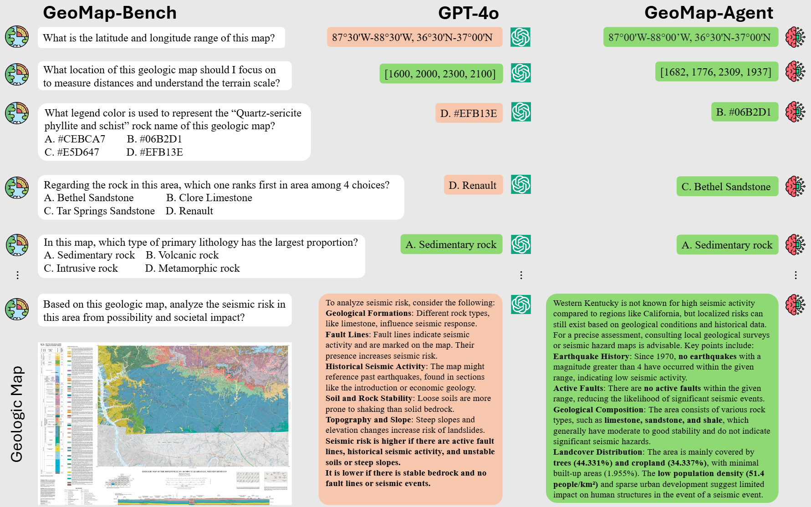
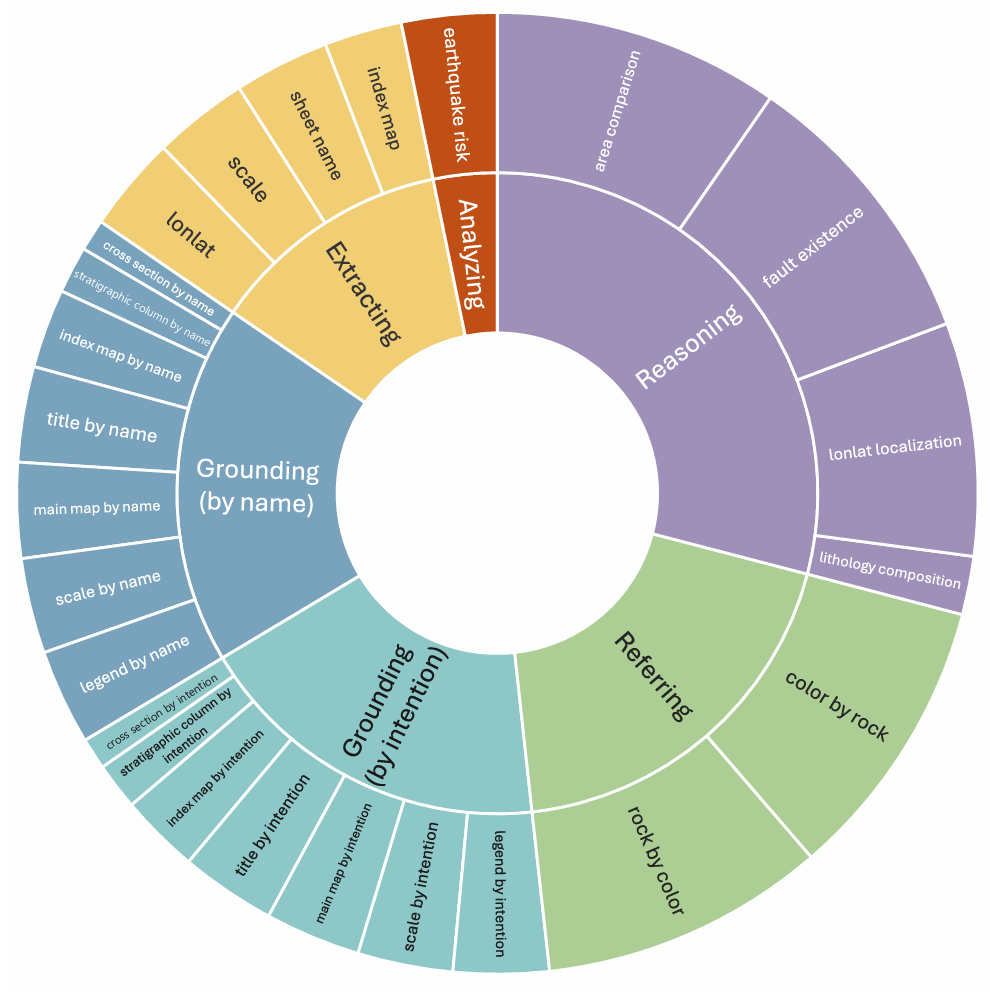
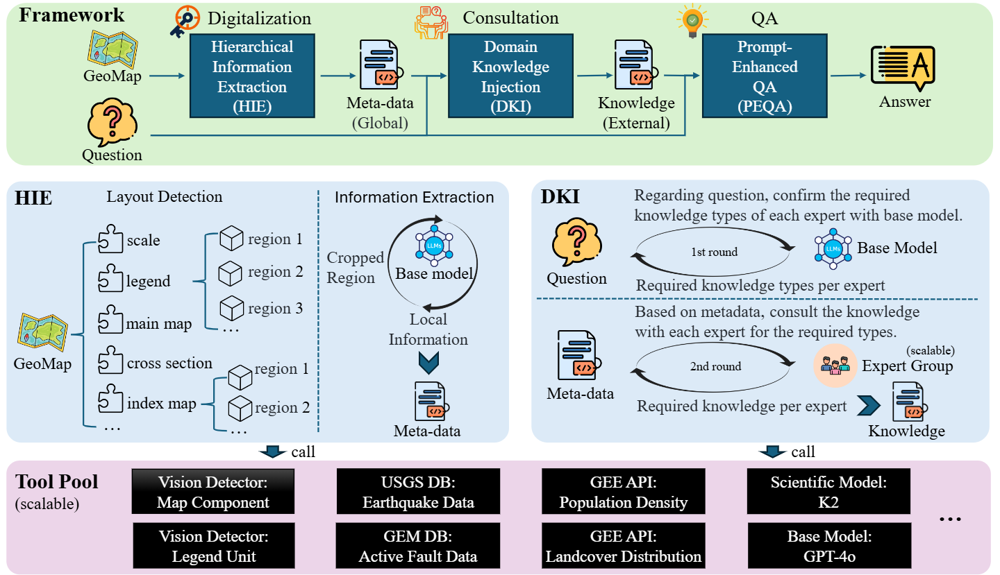
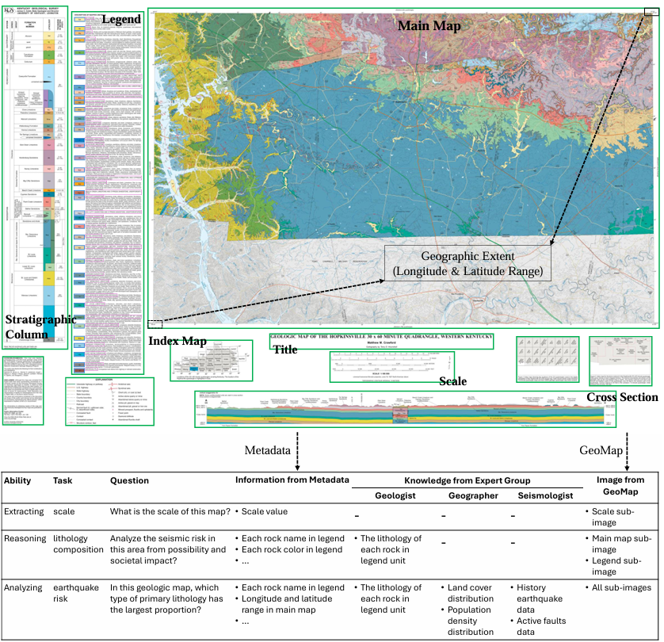

# Em<a>p</a>owering G<a>e</a>ologic M<a>a</a>p Holisti<a>c</a> Und<a>e</a>rstanding with MLLMs
<!-- # PEACE: Em**p**owering G**e**ologic M**a**p Holisti**c** Und**e**rstanding with MLLMs -->

<p align="center">
  
  
 
</p>

<p align="center">
  <a href="https://arxiv.org/abs/2501.06184"><b>[📜 Paper]</b></a> •
  <a href="https://huggingface.co/datasets/microsoft/PEACE"><b>[🤗 HF Dataset]</b></a> •
  <a href="https://github.com/microsoft/PEACE"><b>[🐱 GitHub Code]</b></a>
  <a href="https://www.youtube.com/watch?v=NukDoCJgU-s"><b>[🎞️ YouTube Video]</b></a>
</p>

<p align="center">
    
</p>

## 📢 News and Updates
- 2025/01/10: 🔥GitHub Code repo (GeoMap-Agent) released.
- 2025/01/10: 🔥HuggingFace Dataset repo (GeoMap-Bench) released.
- 2025/01/13: 🔥Arxiv paper (PEACE) released.
- 2025/02/27: 🔥Accepted by CVPR'25.
- 2025/03/25: 🔥Add metrics measurement script.
- 2025/04/22: 🔥Add interactive demo video.
## 📖 Table of Contents

- [Introduction](#-introduction)
- [GeoMap-Bench](#-geomap-bench)
- [GeoMap-Agent](#-geomap-agent)
- [Leaderboard](#-leaderboard)
- [Data Display](#-data-display)
- [Quickstart](#-quick-start)
- [Disclaimer](#-disclaimer)
- [Citation](#-citation)

## 🌟 Introduction
Geologic map, as a fundamental diagram in geology science, provides critical insights into the structure and composition of Earth's subsurface and surface. These maps are indispensable in various fields, including disaster detection, resource exploration, and civil engineering.

## 📖 GeoMap-Bench
We present **GeoMap-Bench**, a new benchmark consisting of 124 geologic maps and 3,864 multimodal multiple-choice questions with diverse annotations. The distribution of questions in the GeoMap-Bench. It consists of 25 task types that measure critical geological map interpretation abilities across **five** aspects: *grounding, extracting, referring, reasoning, and analyzing*.

<p align="center">
    
</p>

## 🌍 GeoMap-Agent
We introduce **GeoMap-Agent**, the inaugural agent designed for geologic map understanding, which features three modules: Hierarchical Information Extraction(HIE), Domain Knowledge Injection (DKI), and Prompt-enhanced Question Answering (PEQA). Inspired by the interdisciplinary collaboration among human scientists, an AI expert group acts as consultants, utilizing a diverse tool pool to comprehensively analyze questions.

<p align="center">
    
</p>

## 🧮 Leaderboard
Through comprehensive experiments, GeoMap-Agent achieves an overall score of 0.811 on GeoMap-Bench, significantly outperforming 0.369 of GPT-4o.

| Method               | Extracting | Grounding | Referring | Reasoning | Analyzing | Overall |
|----------------------|------------|-----------|-----------|-----------|-----------|---------|
| Random               | 0          | 0         | 0.250     | 0.250     | 0         | 0.100   |
| GPT-4o               | 0.219      | 0.128     | 0.378     | 0.507     | 0.612     | 0.369   |
| GeoMap-Agent         | 0.832      | 0.920     | 0.886     | 0.588     | 0.831     | 0.811   |

## 🔍 Data Display
We visualize the components of a typical geologic map, highlighting the complex nature of *cartographic generalization*. Additionally, we showcase sample questions from GeoMap-Bench and demonstrate how our GeoMap-Agent integrates various sources of contextual information to address them.
<p align="center">
    
</p>

## ⏩ Quick Start
<details open>
<summary>Installation</summary>

<ul><li>Step1: Clone GeoMap-Agent code repository</li></ul>
<div class="language-plaintext highlighter-rouge">
<pre class="highlight">
<code>git clone https://github.com/microsoft/PEACE.git
cd PEACE</code>
</pre>
</div>

<ul><li>Step2: Clone GeoMap-Bench dataset repository</li></ul>
<div class="language-plaintext highlighter-rouge">
<pre class="highlight">
<code>git lfs install
git lfs clone https://huggingface.co/datasets/microsoft/PEACE data</code>
</pre>
</div>

<ul><li>Step3: Download layout detection models</li></ul>
<div class="language-plaintext highlighter-rouge">
<pre class="highlight">
<code>pip install gdown
gdown https://drive.google.com/uc?id=1f7dUdfA_W8He9czG6SoYQBmUsSPrA6MZ
unzip models.zip -d dependencies</code>
</pre>
</div>

<ul><li>Step4: Install dependencies</li></ul>
Use a Python 3.11 environment. Install the pinned PyTorch and torchvision versions together; older torchvision releases can install an older PyTorch without the <code>torch.compiler</code> API required by Transformers.
<div class="language-plaintext highlighter-rouge">
<pre class="highlight">
<code>python -m pip install --upgrade -r requirements.txt
python -m pip check
python -c "import torch, torchvision; from transformers.integrations import integration_utils; from sentence_transformers import util; print(torch.__version__, torchvision.__version__)"</code>
</pre>
</div>

The layout detectors load full-model PyTorch checkpoints. Only use model files from trusted sources, such as the Step3 download; loading an untrusted checkpoint can execute arbitrary code.

<ul><li>Step5: Configure LLMs API endpoint and key in utils/api.py</li></ul>

</details>


<details open>
<summary>Evaluation</summary>

 <div class="language-plaintext highlighter-rouge">
<pre class="highlight">
<code>python eval.py --copilot_mode HIE,DKI,PEQA --dataset_source usgs
python calc_metrics.py --copilot_mode HIE,DKI,PEQA --dataset_source usgs</code>
</pre>
</div>

</details>

## ⚡ Disclaimer
Due to the inherent limitations of large language models, issues such as hallucinations may occur.


## 🔗 Citation
```
@article{huang2025peace,
  title={PEACE: Empowering Geologic Map Holistic Understanding with MLLMs},
  author={Huang, Yangyu and Gao, Tianyi and Xu, Haoran and Zhao, Qihao and Song, Yang and Gui, Zhipeng and Lv, Tengchao and Chen, Hao and Cui, Lei and Li, Scarlett and others},
  journal={arXiv preprint arXiv:2501.06184},
  year={2025}
}
```

## 👀 License
This repository is licensed under the [MIT](https://github.com/microsoft/PEACE/blob/main/LICENSE) License.
The use of Ultralytics library is subject to the [AGPL-3.0](https://github.com/ultralytics/ultralytics/blob/main/LICENSE) License.
